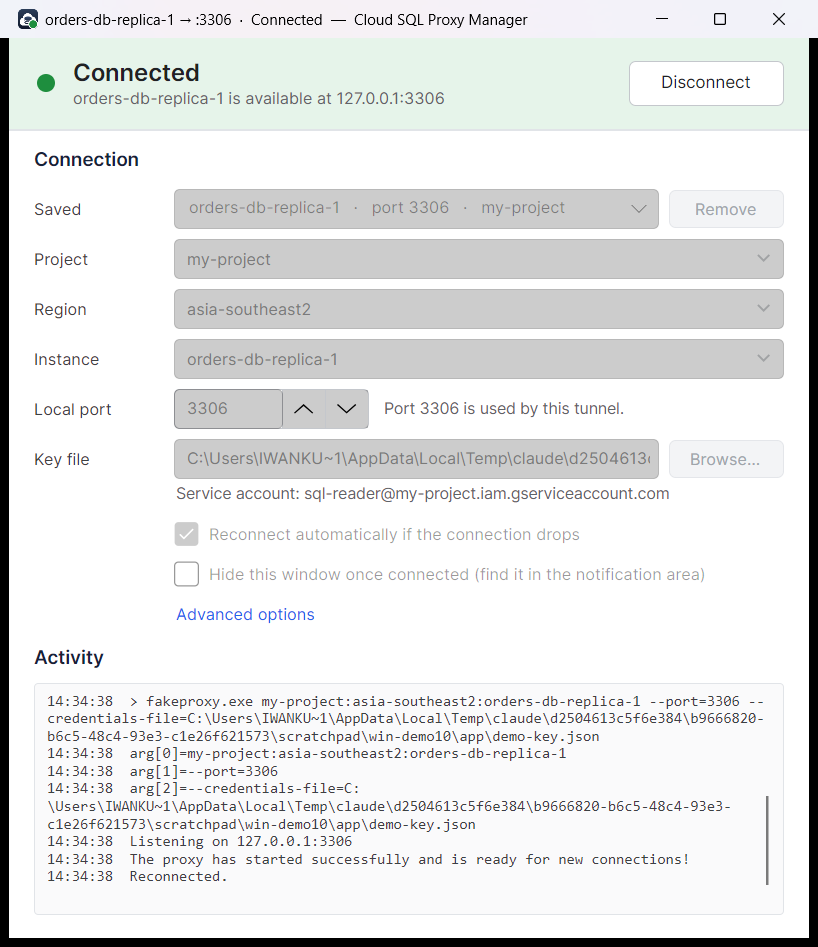
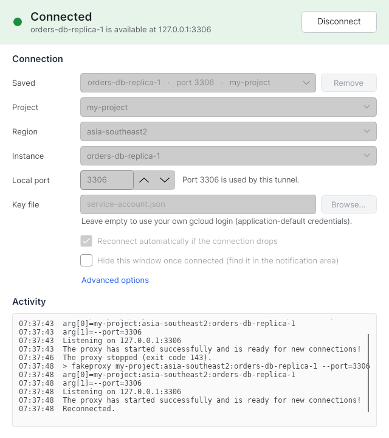

# Cloud SQL Proxy Manager (Windows, Linux, macOS)

A small desktop app that opens a tunnel to a Google Cloud SQL instance and keeps it
open. Pick the instance, the local port and the key file, press **Connect**, and it
stays connected until you press **Disconnect**. Every package carries its own .NET
runtime and Google's `cloud-sql-proxy`, so nothing has to be installed first.

This is the cross-platform edition (Avalonia UI). The original Windows-only edition in
`..\cloudsql-proxy-manager` keeps working and looks the same.



The same window on Linux (captured in the container test rig, so the frame is missing):



## Packages

| File | For |
| --- | --- |
| `dist\CloudSqlProxyManager-win-x64.exe` | Windows 10/11, one file, portable |
| `dist\CloudSqlProxyManager-linux-x64.tar.gz` | Linux desktops on Intel/AMD (Ubuntu, Mint, Fedora…) |
| `dist\CloudSqlProxyManager-linux-arm64.tar.gz` | Linux on ARM (Raspberry Pi 5, Ampere) |
| `dist\CloudSqlProxyManager-osx-arm64.tar.gz` | macOS on Apple Silicon (M1 and later) |
| `dist\CloudSqlProxyManager-osx-x64.tar.gz` | macOS on Intel |

**Windows**: run the `.exe`. **Linux**: unpack, then `./CloudSqlProxyManager`, or
`./install.sh` to add it to the app menu (user profile only, no root). **macOS**:
unpack, drag `Cloud SQL Proxy Manager.app` to Applications; the first start needs
right-click → Open because the app is not Apple-signed. Each archive has a README
with the details.

## Use it

1. Choose the **Project**, **Region** and **Instance**, or type them. The three fields
   keep in step: a project offers only its regions, a region only its instances, and
   changing one clears a value below it that no longer fits. Anything you type that is
   not listed is accepted as is, and joins the lists once you have connected to it. You
   can also paste a full `project:region:instance` into **Instance**.
2. Set the **Local port**. The app says whether it is free.
3. Choose the service account **Key file** (JSON), or leave it empty to use your own
   `gcloud auth application-default login`.
4. Press **Connect**, then point DBeaver (or any client) at `127.0.0.1` and the local port.

It runs the same command you would type by hand:

```
cloud-sql-proxy "project:region:instance" --port=3306 --credentials-file="/path/key.json"
```

## The instance list

The instances offered on first run are listed in `src\Core\KnownInstances.cs`. To add
more without rebuilding, put a file named `CloudSqlProxyManager.instances.txt` beside
the program (or in the settings folder) with one `project:region:instance` per line.
Anything you connect to is also remembered under **Saved**, with its port, key file
and options.

## Two instances at once

Start the app twice. Each window is its own tunnel on its own local port. A second
copy opens on the first saved connection whose port is still free, and the title bar
and the notification-area icon show the instance, the port and the state.

## Port already in use

Beside **Local port** the app shows live whether the port is free. If it is taken it
names the program holding it (via the system's own tools: `netstat`-style API on
Windows, `ss` on Linux, `lsof` on macOS) and offers the next free port.
**Connect** refuses to start on a busy port.

## Dropped connections

With **Reconnect automatically** ticked (the default), the app brings the tunnel back
by itself until you press **Disconnect**:

| What happens | What the app does |
| --- | --- |
| The proxy process dies or exits with an error | Restarts it after 2 s, then 5, 10, 20, 30 s while it keeps failing. The proxy's own error stays on screen. |
| The network or VPN drops | Notices within about 15 s, stops the proxy, waits for the network, then starts a fresh proxy. |
| The computer wakes from sleep | Restarts the proxy so it does not carry stale certificates. |
| You press **Disconnect** | Stops the proxy and stops trying. |

How the network check works: every 10 seconds the app tries a plain TCP connection to
`sqladmin.googleapis.com:443` (the API the proxy itself needs) and treats two failures
in a row as a drop. It deliberately never opens a test connection *through* the tunnel:
half-open connections count as failed handshakes on MySQL and can get your address
blocked (`max_connect_errors`). If that host is never reachable directly (a firewall or
web proxy in the way), the check switches itself off for the session and only the proxy
process is watched; the Activity log says so.

After a reconnect your database client has to open a new connection; the old one is gone.

## Where things go

| | Settings | Unpacked proxy |
| --- | --- | --- |
| Windows | beside the `.exe` (portable); `%APPDATA%\CloudSqlProxyManager` if that folder is read-only | `%LOCALAPPDATA%\CloudSqlProxyManager` |
| Linux | `~/.config/CloudSqlProxyManager` | `~/.local/share/CloudSqlProxyManager` |
| macOS | `~/Library/Application Support/CloudSqlProxyManager` | same folder |

The built-in proxy is unpacked on first connect (about 37 MB) and checked against its
SHA-256 every time the app starts using it. To use a different proxy, choose it under
**Advanced options > Proxy program**. **Extra arguments** is passed to the proxy as
typed, e.g. `--private-ip` or `--auto-iam-authn`.

Other things worth knowing:

- **Hide this window once connected** (ticked by default) tucks the window away in the
  notification area as soon as the tunnel is up; click the icon to bring it back.
  Minimising does the same. On macOS, where there is no such area, the window
  minimises to the Dock instead. The icon carries a small light: none (off), amber
  (connecting), green (connected), red (reconnecting). A reconnect never hides a
  window you have open.
- Closing the window disconnects. On Windows the proxy is tied to the app by a job
  object, so even a killed app takes its proxy with it. On Linux and macOS the proxy is
  stopped when the app exits normally; a `kill -9` of the app leaves it for you to stop.

## Build

Needs the .NET 10 SDK and PowerShell 7 on Windows (the build runs on Windows and
produces every target; it does not need a Mac or a Linux box).

```
.\tools\get-proxy.ps1      # once: fetch Google's proxy for all targets, checksum-verified
.\build.ps1                # publishes and packages all five targets into dist\
.\build.ps1 -Test          # also runs the controller tests on this machine
.\tests\linux\run.ps1 -OutDir $env:TEMP\proxy-linux    # Linux build in Docker with screenshots
```

- `tools\get-proxy.ps1` downloads the pinned version from Google's release bucket and
  refuses a file unless its SHA-256 matches the GitHub release notes. `-Version v2.x.y`
  moves to a newer one.
- `build.ps1 -Test` runs the reconnect logic against a stand-in proxy, and checks that
  the built-in proxy unpacks, runs, and reports a real start-up error correctly.
- `tests\windows\ui-demo.ps1` drives the real Windows window through UI Automation
  (first run, the cascading fields, connect, crash, second copy, busy port, hide on
  connect) and saves a screenshot of each state.
- `tests\linux\run.ps1` runs the controller tests plus the real window on a virtual
  display inside a container built from Microsoft's `runtime-deps` image (what a bare
  Linux box has), driven with xdotool.
- The icon is drawn by `tools\IconFactory.cs`; `tools\make-icons.ps1` renders the `.ico`,
  `.icns` and PNGs from it, so every platform shows the same picture.

| Path | What |
| --- | --- |
| `src\Core\ProxyController.cs` | Starts, watches and restarts the proxy; all reconnect logic |
| `src\Core\BundledProxy.cs` | Unpacks and verifies the built-in proxy |
| `src\Core\PortInspector.cs` | Is a port in use, and by which program (per OS) |
| `src\Core\Platform.cs` | Settings and data folders per OS |
| `src\Core\KnownInstances.cs` | The instances offered before anything is saved |
| `src\App\MainWindow.axaml(.cs)` | The window and notification-area icon |
| `src\App\ComboField.cs` | The type-or-choose field used for project, region and instance |
| `src\App\Theme.axaml` | Colours and control styles |
| `packaging\` | Linux `.desktop` + `install.sh`, macOS `Info.plist` |
| `tests\` | Stand-in proxy, controller tests, Linux container rig |

`cloud-sql-proxy` is Google's, licensed under Apache 2.0:
<https://github.com/GoogleCloudPlatform/cloud-sql-proxy>
